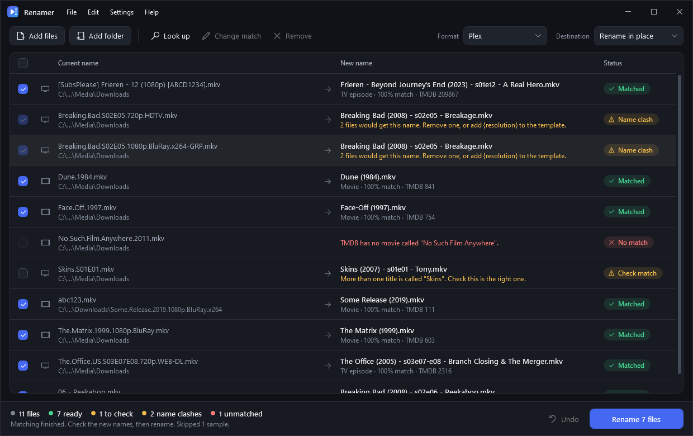

# Renamer

A Windows app that renames downloaded movies and TV episodes for Plex, Kodi or Reelhouse, using
[TMDB](https://www.themoviedb.org/) to find the right titles.

Drag files or folders onto the window, check the new names, then click **Rename**. Nothing changes
on disk until you click, and **Undo** puts everything back.



## Getting started

1. Download `Renamer.exe` from the [Releases page](../../releases), or build it yourself as described
   under [Building from source](#building-from-source). It is a single 62 MB file with nothing else to
   install, and you can keep it anywhere. It needs 64-bit Windows 10 or 11, and has only been run on
   Windows 10 so far.
2. Open **Settings > TMDB API key**, paste your key and press **Test key**. You can get a key free from
   your [TMDB account settings](https://www.themoviedb.org/settings/api). Either the "API Key" or the
   longer "API Read Access Token" works.

## Using it

1. **Add files.** Drag files or folders onto the window, use **Add files** or **Add folder**, or drop
   them on `Renamer.exe` itself. Folders are searched all the way down. Only video files are listed,
   and samples and trailers are skipped.
2. **Check the new names.** Files are looked up on TMDB as soon as they are added, and each row shows
   its old name, its new name and a status. Any problem is written under the new name. Hover over a
   row to see the full paths and how the file name was read.
3. **Fix any that are wrong.** Double-click a row, or select it and press **Change match**, to search
   TMDB yourself. For a TV show you can apply your choice to every file read as that show.
4. **Rename.** Choose a format and a destination at the top right, then press the rename button at the
   bottom. Only ticked rows are renamed.

To start again, press **Clear list**. It only empties the list, and no files on disk are touched.

While files are renamed or moved, a progress bar runs along the bottom of the window, and the app's
taskbar button fills up too. When files go to another drive, it also shows how much has been copied,
the speed and the time left, and each row shows how far its own copy has got. **Stop** cancels the
file being copied, keeping the original, and leaves the rest of the list alone.

### What each status means

| Status | Meaning | What to do |
| --- | --- | --- |
| Matched | A confident match, ticked and ready | Nothing |
| Check match | A best guess, such as when two shows share a name. Left unticked. | Tick it if it's right, or use **Change match** |
| No match | TMDB found nothing | Use **Change match** to search yourself |
| Error | The lookup failed, such as a rejected key or no connection | Fix the cause, then press **Look up** |
| Name clash | The new name is already taken, or another file in the list would get it too | Remove one, or add `{resolution}` to the naming template |
| Not ready | **Move to library** is on, but that library folder isn't set | Set it in **Settings > Naming** |
| Already named | The file already has the right name | Nothing |
| Queued, Renaming, Copying | Being renamed or moved right now. Copying shows how much of the file is done. | Nothing, or **Stop** to halt |
| Renamed | Done | **Undo** if you change your mind |
| Failed | The rename didn't work. The row says why. | Fix the cause, then tick the row and rename again |

### Where files go

Choose this with **Destination** at the top right.

- **Rename in place** (default) keeps each file in its folder and changes only its name.
- **Move to library** also moves files into the chosen format's folder layout, under the movie and TV
  folders you set in **Settings > Naming**.

### Formats

Choose this with **Format** at the top right.

| Format | Movie | TV episode |
| --- | --- | --- |
| Reelhouse (default) | `The Matrix (1999)/The Matrix (1999).mkv` | `Breaking Bad (2008)/Series 2/Breaking Bad (2008) - 2x05 - Breakage.mkv` |
| Plex | `The Matrix (1999)/The Matrix (1999).mkv` | `Breaking Bad (2008)/Season 02/Breaking Bad (2008) - s02e05 - Breakage.mkv` |
| Plex + TMDB ID | `The Matrix (1999) {tmdb-603}/The Matrix (1999) {tmdb-603}.mkv` | `Breaking Bad (2008) {tmdb-1396}/Season 02/Breaking Bad (2008) - s02e05 - Breakage.mkv` |
| Kodi | `The Matrix (1999)/The Matrix (1999).mkv` | `Breaking Bad (2008)/Season 02/Breaking Bad S02E05 - Breakage.mkv` |

The folders only apply when moving to a library. Files holding several episodes are written the way
each app expects: `s01e01-e03` for Plex, `S01E01E02E03` for Kodi and `1x01-03` for Reelhouse.

If you edit the templates, the format changes to **Custom**. Templates that exactly match one of the
formats show that format's name instead.

### Keyboard shortcuts

| Keys | Action |
| --- | --- |
| Ctrl+O | Add files |
| Ctrl+Shift+O | Add a folder |
| F5 | Look up on TMDB |
| Ctrl+M | Change match for the selected file |
| Del | Remove the selected files from the list. Nothing is deleted from disk. |
| Ctrl+Z | Undo the last rename |
| Ctrl+, | Open Settings |

## Settings

| Page | What it controls |
| --- | --- |
| TMDB | API key (stored encrypted), language for titles, whether to look files up automatically |
| Naming | Format, the four naming templates, where files go, library folders |
| Filename regex | The patterns that read title, year, season and episode from a file name, with a box to try them out |
| Clean-up rules | Regex find and replace, either on the file name before matching or on the final new name |
| Files | Video file types, subtitle handling, and the regex for files to skip |
| Appearance | Light or dark theme, or match Windows |

### Filename regex

These styles of file name are read out of the box:

- `Show.S01E02`, `Show.S01E02E03` and `Show.S01E02-E03`
- `Show 1x02` and `Show 1x02-03`
- `Show Season 1 Episode 2`
- `Show.2024.03.15`, matched by air date
- `Show - 12`, the anime style, counted through the show's seasons
- `Movie.2019` and `Movie`

If a file name has no title, the folders around it are used, so
`Breaking Bad (2008)/Season 2/05 - Breakage.mkv` and `Movie.Name.2019.1080p/abc123.mkv` both work.

To add your own, patterns are tried from the top and the first match wins. Matching ignores case. These
named groups are read: `title`, `year`, `season`, `episode`, `episode_end`, `absolute`, `air_year`,
`air_month`, `air_day`. A pattern for `Show.102` is included but turned off, because it misreads
movie titles like `Fahrenheit.451`.

### Clean-up rules

**Before matching** rules tidy the file name before the patterns read it. Two are on by default: they
remove a website name and a `[release group]` from the start of the name.

**Final name** rules change the new name after the template fills it in, and `$1` in the replacement
inserts a captured group.

### Naming templates

`{title}` or `{show}`, `{year}`, `{season}`, `{episode}`, `{episode_end}`, `{episode_range}`,
`{episode_list}`, `{episode_to}`, `{episode_title}`, `{air_date}`, `{tmdb_id}`, `{resolution}`,
`{source}`, `{codec}`, `{original_name}`

For a file holding several episodes, `{episode_range}` gives `-e06`, `{episode_list}` gives `E06` and
`{episode_to}` gives `-06`. All three are empty for a single episode.

Add a format after a colon: `{season:00}` gives `02`, and `{air_date:yyyy.MM.dd}` gives `2009.04.05`.
Use `/` in a folder template to make subfolders. Values that are empty are removed along with their
brackets and separators, and characters Windows does not allow are always replaced.

## Keeping your files safe

- **Nothing is overwritten.** If a file with the new name already exists, your file is left alone and
  the row says why. Two files that would get the same name are both held back.
- **Subtitles follow their video.** Subtitles sharing the video's name move with it and keep their
  language tags, so `Old.en.srt` becomes `New.en.srt`. If that name is taken, the subtitle stays put.
- **Originals are kept until a copy is complete.** A move to another drive copies to a temporary name,
  checks the size, and only then removes the original.
- **Undo goes back in steps.** It reverses the most recent batch, and pressing it again goes further
  back, up to the last 20 batches. It also works after restarting the app. If another file has since
  taken an old name, Undo reports it and leaves both files where they are.

## Known limits

- On Windows 11, hovering over the maximize button doesn't show the snap layouts menu, because the app
  draws its own title bar.
- The app keeps its own colors in Windows High Contrast mode.

## Where things are kept

Settings, rename history and the error log are in `%APPDATA%\Renamer`. Delete that folder to reset
the app. The API key is encrypted for your Windows account, so it won't work if the settings are copied
to another account or PC, and you'd need to enter it again.

Set the `RENAMER_DATA_DIR` environment variable to keep them somewhere else, such as for testing.

## Troubleshooting

**Dragging onto the window shows a "no entry" cursor.** Windows blocks dragging between programs
running at different permission levels. Start Renamer normally, not with "Run as administrator".

## Building from source

Needs the [.NET 10 SDK](https://dotnet.microsoft.com/download).

| Folder | What's in it |
| --- | --- |
| `src/Renamer.Core` | File name parsing, the TMDB client, matching, naming and renaming, with no UI |
| `src/Renamer.App` | The WPF app. Its colors and control styles are in `Views/Theme`. |
| `tests/Renamer.Tests` | Tests for `Renamer.Core` |

To run the tests:

```bash
dotnet test
```

To run the app:

```bash
dotnet run --project src/Renamer.App
```

To build `dist\Renamer.exe`:

```bash
dotnet publish src/Renamer.App -c Release -r win-x64 --self-contained -p:PublishSingleFile=true -p:EnableCompressionInSingleFile=true -p:IncludeNativeLibrariesForSelfExtract=true -p:DebugType=none -o dist
```

## Credits

This product uses the TMDB API but is not endorsed or certified by TMDB.
